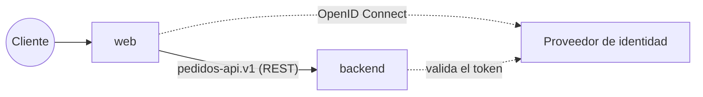

# Mapa de pedidos

Qué componentes tiene el producto, qué hace cada uno y cómo se comunican. Se actualiza en el mismo PR que añade o retira un componente o cambia cómo se comunican, junto con `producto.yaml`.

## Componentes

| Componente | Qué hace | Expone | Consume |
|---|---|---|---|
| `backend` | Catálogo de productos con su stock y creación de pedidos. Es el dueño de los datos de productos y pedidos | `pedidos-api.v1` | — |
| `web` | Interfaz del cliente para ver productos y hacer pedidos | — | `pedidos-api.v1` |

## Cómo se comunican

Sin eventos por ahora: el piloto no tiene broker.

## Dependencias fuera del producto

| Dependencia | Tipo | Para qué se usa |
|---|---|---|
| Proveedor de identidad | Plataforma | Identificar a los clientes (OpenID Connect) |
